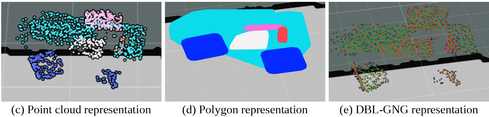

# Per-Object DBL-GNG for Semantic Mapping

Repository providing the DBL-GNG source code for the paper (manuscript in preparation)
> Intelligent Robot Guidance: Mask-Based Object Perception and Semantic Mapping on an Indoor Guide Robot Using YOLO11s-seg and an RGB-D Camera<br/>
> Bharata Kukuh Hariyanto, Mohamad Yani, Moch. Iskandar Riansyah, Naoyuki Kubota, Fajar Hidayatullah and Muhammad Rio Fernanda

<p align="center">
  
</p>

*Left to right: object point clouds, 2D polygons, DBL-GNG networks (red: nodes, green: edges).*

This repository contains **only the DBL-GNG stage**: a ROS 2 node that accumulates the points of each mapped object and trains one
[Distributed Batch Learning Growing Neural Gas](https://github.com/CornerSiow/DBL-GNG) network per object.
The segmentation, RGB-D point cloud, polygon and map fusion nodes of the pipeline are not included.

## Setup
Tested on ROS 2 Humble with Python 3 and NumPy.
```bash
mkdir -p ~/gng_ws/src
cp -r dbl_gng_objects ~/gng_ws/src/
cd ~/gng_ws
source /opt/ros/humble/setup.bash
colcon build --packages-select dbl_gng_objects
source install/setup.bash
```

## Run the code
```bash
ros2 run dbl_gng_objects gng_objects_node
```
The node needs a semantic mapping system that publishes the two input topics below.

| Direction | Topic | Type | Content |
|---|---|---|---|
| in | `/ltc/global_objects_pointcloud` | `sensor_msgs/PointCloud2` | fields `x`, `y`, `z`, `class_id` in the `map` frame |
| in | `/ltc/global_semantic_map` | `std_msgs/String` | JSON: `{"objects": [{"global_id", "class_id", "bbox_map": {"min_bound", "max_bound"}, "centroid_map"}]}` |
| in | `/ltc/reset_map_cmd` | `std_msgs/Empty` | reset the networks (archived if `persist_file` is set) |
| in | `/ltc/gng_clear_saved` | `std_msgs/Empty` | delete all networks, including saved ones |
| out | `/ltc/gng_markers` | `visualization_msgs/MarkerArray` | nodes and edges per object |
| out | `/ltc/gng_points` | `sensor_msgs/PointCloud2` | accumulated object points |

## Customize
| Parameter | Default | Meaning |
|---|---|---|
| `voxel` | 0.02 | voxel size (m) for point merging |
| `max_points` | 1500 | maximum points per object |
| `train_min_points` | 50 | minimum points before training |
| `train_interval_s` | 2.0 | minimum time between trainings (s) |
| `epochs` | 40 | training epochs |
| `margin` | 0.15 | bounding box margin (m) for assigning points to objects |
| `persist_file` | empty | `.npz` file that keeps the networks between sessions |

The number of nodes is `M = clip(N/15, 20, 200)` and the number of starting points is `K = clip(M/8, 3, 12)`, with `N` the number of points.

Example:
```bash
ros2 run dbl_gng_objects gng_objects_node --ros-args -p train_interval_s:=1.0 -p persist_file:=~/gng.npz
```

## Tests
```bash
cd dbl_gng_objects
python3 -m pytest
```

## Acknowledgement
`dbl_gng_core.py` is a port of [CornerSiow/DBL-GNG](https://github.com/CornerSiow/DBL-GNG) (MIT License, Mathematics 12(12):1909, 2024).
Please cite that work when using the algorithm.

## License
Apache-2.0, see [LICENSE](./LICENSE). The ported DBL-GNG core keeps the MIT License, see [LICENSE-DBL-GNG](./LICENSE-DBL-GNG).
